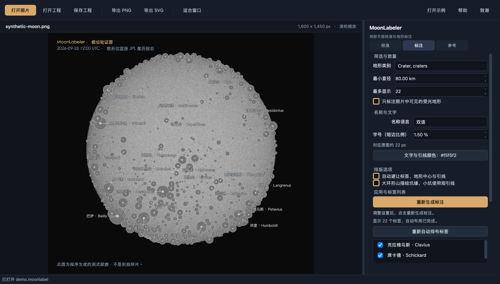

# MoonLabeler

**Author / 作者：Fluorine Zhu** · **Version / 版本：0.7.12** · **GPL-3.0-or-later**

Register your own lunar photographs, place editable terrain labels, and export annotated PNG / SVG images.
在自己的月面照片上配准地形、排布可编辑标签，并导出 PNG / SVG。

[中文使用说明](README.zh-CN.md) · [Update History / 更新历史](UPDATE_HISTORY.md) · [Acknowledgements / 致谢](ACKNOWLEDGEMENTS.md) · [Third-party notices](THIRD_PARTY_NOTICES.md) · [License](LICENSE)



## 中文

MoonLabeler 是用 Python / Qt 编写的桌面月面照片标注工具，支持整月盘、局部照片、旋转及镜像。界面目前为中文。

### 功能

- 自动识别：匹配内置 LROC 纹理；也可拟合较完整的月盘外缘，并联合验证月相和月海纹理；局部图再通过坑群搜索目录；仍失败时使用小型 LOLA 高程数据生成阴影参考。
- 参考点辅助自动配准：确认一两个已知地形点即可搜索附近区域，由周围纹理验证比例、旋转和镜像，再生成标注。
- 手动校准：以至少 3 个已知地形中心求解比例、旋转、偏移和镜像；显示逐点偏差。
- 辅助找坑、名称确认和参考点配准合并在同一流程；手动补点默认折叠，识别失败保留当前候选和参考点。
- 疑似坑检测：本地 OpenCV 检测圆形 / 椭圆坑缘，支持修正中心与导出 CSV。
- 照片画布在左、紧凑检查器在右；低频参数折叠，候选坑确认操作固定在页脚。
- 标注布局：哥白尼、第谷、柏拉图等常见重要地形先占位，普通标签及其中心不抢占这些位置；必要时对重要标签有限扩大引线范围。自动避让标签、地形中心和引线；按住 Cmd（macOS）或 Ctrl（Windows/Linux）拖动标签，双击改名。
- 候选选择综合投影大小、坑缘与周围地表对比及区域分布；主地形优先于附属字母坑，避让后从其余候选补位，数量上限约束最终显示结果。
- 按投影视直径分大、中、小三档字号，默认短边的 **1.8% / 1.5% / 1.2%**；“字号递减”默认每档减 **0.3 个百分点**，设为 0 则统一字号。新照片的标签上限为 **200**。
- 默认近白色文字与深色描边；大环形山默认用平滑椭圆，可选坑缘轮廓，小坑使用短引线。
- 可选着陆点图层：阿波罗 11、12、14、15、16、17 与嫦娥三、四、五、六号；默认关闭，浅青色十字与短引线，使用小档字号。
- 设置修改后，点击 **“重新生成标注”** 统一应用。
- 中文译名优先采用樊仕达（10deg）提供的 LPND 地名资料；手工补录与旧词表兜底保留各自来源，旧译名仍可搜索。内置资料已更新至 2026-10-16 的 10,431 条综合快照，其中 9,040 条含中文，1,391 条为英文待译名。扩展资料中的坐标与 VMA 独有地貌暂不合并到现有 USGS 配准目录。
- 保存 `.moonlabel` 工程，导出与原图同尺寸 PNG 或可编辑 SVG；另提供 LOLA DEM 光照模拟参考。

支持 WinJUPOS 的 `YYYY-MM-DD-HHMM.T`、`YYYY-MM-DD-HHMMT` 以及常见的 `HHMM_T` 写法，可带拍摄者前缀和处理后缀。例如 `2026-08-31-2137_7-Moon_lapl3_ap311(1).tif` → **2026-08-31 21:37:42 UTC**；末位是十分之一分钟，不是秒。无效日期不导入，工程中的已保存时间优先，导入后仍可修改。规范依据为 [WinJUPOS 官方安装包](https://jupos.org/gh/download.htm)内英文帮助的 *Image measurement → Image → WinJUPOS-Conventions*；若采集软件实际用本地时间命名，需自行换算。

高倍单坑照片增加低分辨率长弧椭圆候选，检查整圈边缘方向与分布；大半径搜索降低工作分辨率以减少计算。候选中心仍需核对，找到一个椭圆不等于确定坑名或完成自动配准。

### 从源码运行

需要 **Python 3.12 或更高版本**。主要在 macOS 上开发与测试。

```bash
git clone https://github.com/Fluorine7/MoonLabeler.git
cd MoonLabeler
./start-mac.command
```

也可在 macOS 双击 `start-mac.command`。首次启动会创建虚拟环境、安装依赖并构建最小 OpenCV；需先安装 Xcode Command Line Tools（`xcode-select --install`）。已有环境会移除旧 OpenCV 安装包，缺少最小构建时自动重建。后续启动复用已有构建。
源码构建还需要 C++ 编译器：Windows 安装 Visual Studio Build Tools 的“使用 C++ 的桌面开发”组件；Linux 安装 `build-essential`。CMake / Ninja 由 Python 构建环境安装。
Windows 可用 `pwsh -File build-windows.ps1` 打包成免安装的 `dist/MoonLabeler/MoonLabeler.exe`（PyInstaller 单文件夹，内含最小 OpenCV、JPL 星历与 FITS 支持；缓存位于 `%LOCALAPPDATA%/MoonLabeler/cache`）。
其他系统可通过 Python 启动，相关界面尚未完成平台实测。Ubuntu / Debian 还需安装 Qt 的系统库和中文字体：`sudo apt-get install libegl1 libopengl0 libgl1 fonts-noto-cjk`。

```bash
python3 -m venv .venv
# macOS / Linux
source .venv/bin/activate
# Windows PowerShell: .venv\Scripts\Activate.ps1
python -m pip install --upgrade "pip>=26.2" "setuptools>=83"
python -m pip uninstall -y opencv-python opencv-contrib-python opencv-python-headless opencv-contrib-python-headless
python -m pip install --upgrade .
python -m moonlabeler
```

可选跨平台 GPU 加速：在项目目录激活虚拟环境后运行 `python -m pip install ".[gpu]"`。通过 [wgpu](https://wgpu-py.readthedocs.io/en/stable/start.html) 自动选择 Metal、Vulkan 或 DirectX 12；是否可用取决于显卡、驱动和上游安装包支持。无需浏览器或 CUDA。已实测 Apple M5 Pro，Windows / Linux 显卡尚待实机验证。

| 系统 | 可尝试的显卡 | 计算接口 |
| --- | --- | --- |
| macOS | Apple M 系列；支持 Metal 的 Intel / AMD Mac 显卡 | Metal |
| Windows 10 / 11 | 支持所需接口与计算功能的 NVIDIA、AMD、Intel 独显或核显 | Vulkan / DirectX 12 |
| Linux | 配有可用 Vulkan 驱动的 NVIDIA、AMD、Intel 独显或核显 | Vulkan |

这表示后端适配范围，不是逐型号测试清单。需安装 `.[gpu]`，且系统、驱动和计算能力通过运行时检测；显卡品牌本身不能保证兼容。软件模拟显卡不会作为 GPU 加速设备使用。

顶部“计算设置”提供“自动选择”“仅 CPU”，显示可用设备，选择保存在本机、下次计算生效，不随照片工程传递。只加速自动识别中的高程阴影参考生成；精确投影、SIFT、配准精修与标注仍使用 CPU。首次运行包含内核编译，临界像素和分布抽样由 CPU 复核。GPU 不可用、计算失败或抽样不符时回退；旧版安装的 `.[apple-gpu]` / MLX 仍作为 Apple 兼容后端，其余情况使用 CPU。小参考图及超出内存限制的 DEM 使用 CPU。

设置 `MOONLABELER_COMPUTE=cpu` 可强制关闭 GPU，`auto` 恢复自动选择；环境变量优先于界面。旧值 `metal` 兼容为 `auto`。未安装 GPU 组件也可正常使用全部功能。

FITS 可选依赖：`python -m pip install astropy`。打开后可点 **“打开示例”** 测试内置的合成工程；它用于演示编辑与校准流程，不用于证明实拍识别准确率。

### 安全更新

更新源码后需同步更新实际虚拟环境和打包环境。运行上面的依赖更新命令，并使用维护中的 Python 安全补丁版本（2026-10-22 基线：3.12.15、3.13.16 或 3.14.8；较新版本可用）。只更新 requirements.txt 不会替换旧的 Python/OpenSSL 或已发布安装包。依赖与原生组件的检查范围、修复及未解决事项见 [安全审计记录](docs/security-audit-2026-10-22.md)。

高位深 RGB TIFF 由 imagecodecs 的 libtiff 4.7.2 或更新版本解码，启动环境需安装更新后的依赖。照片文件不交给 OpenCV 解码。应用 wheel 内置固定源码构建的私有 OpenCV，仅含 core、imgproc、flann、features2d、calib3d、Python 绑定及 EdgeDrawing；不编译 imgcodecs / videoio / highgui、libtiff、OpenJPEG、OpenEXR、FFmpeg 等媒体组件。配准、坑缘检测继续使用上游算法。`requirements.txt` 仅列外部运行依赖；首次安装或更新应用需运行 `pip install .`，只安装依赖文件不会构建原生扩展。

### 使用与限制

“校准 → 拍摄条件 → 拍摄方式”提供 **自动 / 相机直拍 / 目镜后**。自动为默认，必要时尝试目镜畸变校正；相机直拍禁用这条校正分支；目镜后允许校正，但仍优先普通配准，验证门槛不变。当前自动与目镜后使用相同的校正策略，不强制拟合畸变。切换只影响下一次无参考点自动识别，不改变现有标注；参考点配准和手动校准不受影响。设置随工程保存，旧工程缺省为自动，打开新照片恢复自动。

纹理或月缘配准成功时跳过自动坑缘检测，保留已有的辅助候选中心；需要坑群或参考点辅助配准时仍执行检测。目镜重匹配复用本次搜索中未变化的照片特征，只重新提取对齐后的参考图特征；换图或裁取不同区域会重新计算，不增加长期图像缓存。验证标准与标注坐标算法不变。

打开新照片会返回“校准”并收起辅助内容。识别到 WinJUPOS 文件名时自动填入 UTC；其他文件保留当前日期与时间。启动时默认 **UTC 15:00**；确认或修改拍摄日期，点击“自动识别并标注”。“具体时间”默认折叠，展开后通过独立的时、分框设置 UTC 时间，旧工程的秒值保留；收起或更换日期不会重置时间，可点击恢复默认。旧工程保留已保存的精确时间。地点可选；不填时使用地心近似。照片在本机处理。首次自动识别需要下载约 20 MB JPL 星历，坑群精修和高程后备匹配使用约 33 MB LOLA 数据，缓存后可离线使用；自动识别无需 NASA 在线影像或 AI 权重。

自动识别属于实验性功能。强阴影、月缘与极区的严重压缩、模糊、水印、日期错误或候选坑太少时仍可能失败。不能通过验证的结果不会作为地名标注，也不会替换已有配准。可改用已知地形点手动校准。

纹理配准还会用分散的对应点尝试整体投影精修。空间验证按实际月面区域计算，不让照片黑边稀释覆盖率；较完整月盘另以实拍外缘独立检查中心和比例。只有分区留出误差改善且月缘一致时才接受较大的观测方向微调，避免月缘标签的地形端点落入黑背景；不会将引线端点强行移到月缘。原始星历视角与验证记录随工程保存，已有工程需重新执行“自动识别并标注”才能更新配准。

目镜后照片的受限畸变校正复用纹理对应点，并验证真实受光月缘。外缘可独立测得时，按月盘大小计算分布和光学拟合范围，避免黑边阻止校正；少量错误对应点不能拉大空间验证网格。仍要求至少 100 个分散内点、80% 共识、四个独立留出区域和 120° 受光月缘。已验证两张手机目镜后实拍，原图像素不变；不能保证其他目镜、手机或局部视野通过。

0.7.6 不再要求不可见的暗半球全部落在画面内：只有预测的受光外缘不少于 120°、且至少 95% 在画面内，才继续尝试独立月缘测量；最终纹理及畸变验证不变。该版本中因分区预测不稳定而拒绝的 2023-05-27 UTC 11:51 手机实拍，已在 0.7.8 通过一次受限的参考图对齐重匹配解决；原有验证要求不变。失败提示现在保留纹理与目镜校正的原因，不把识别到同一区域误报为可靠标注。

只认得一两个地形时，在“辅助找坑”中确认名称和位置，然后展开“参考点与配准”，点击 **“用参考点自动配准”**。顶部“自动识别并标注”也会优先使用已确认的点。程序复用同一份小型 LOLA 数据，尝试少量局部参考尺度，通过后立即停止搜索；仍需至少 24 个图像对应点、分布覆盖、明暗与细节相关，以及全部参考点位置的一致性。失败保留参考点和原配准。一个点本身不能确定方向和比例；纯手动校准仍默认需要至少三点。

局部坑群识别通过后，会使用同一份约 33 MB 的 LOLA DEM 精修相机与观测方向；局部参考渲染和拟合都考虑地形高度。修正必须通过空间分区留出点与重新渲染的整幅纹理检查，否则保留原配准。该修正不代表反推出的拍摄地点或天平动测量值。

高程后备搜索中，粗略球面参考的对应点和纹理只能用于提名候选区域。模糊极区照片的稀疏匹配可进入含地形高度的投影精修，但必须重新找到足够且分散的对应点，通过明暗、细节与分区留出验证后才能接受。重叠分块的同一结果只精修一次，最多检查两个不同区域；最终接受门槛不变。拼接照片的黑色空白边界由实拍本身确定并排除，坑内阴影仍参与检查。2023-01-03 南极实拍、2020-08-06 北极 Meton 区域和 2004-10-08 南极 Drygalski 区域均通过无参考点配准回归；这些是区域与主要地形定位检查，并非逐像素坑缘精度测量。

参考点辅助搜索也使用上述高程精修，并在精修后再次检查全部已确认点。已有候选通过粗检查时，其他区域中有竞争力的候选仍参与验证；不能区分的结果继续拒绝。导入工程会先检查参数与坐标，非法工程不会替换当前编辑内容。透明图片以黑底合成；16 位彩色 TIFF 保留原精度后作显示拉伸。

坑缘圈仅用于直径至少 35 km 且在照片中足够大的坑，小坑保留短引线。“标注 → 排版选项 → 轮廓形状”默认选择平滑 **椭圆**，也可选 **坑缘轮廓（手绘风）**；点击“重新生成标注”应用。局部坑群路径和含高程投影的后备精修路径优先沿 DEM 中连续的坑缘高地取点，考虑地形高度投影，再拟合椭圆；坑缘轮廓选项保留这些点的不规则形状。数据不足或其他识别路径使用目录参考圈。形状设置与高程坑缘保存在工程中，并用于 PNG / SVG。这些轮廓受 DEM 约 1.9 km 网格、遮挡与配准残差限制，并非逐像素测得的真实坑壁。小拟合残差不等于绝对定位精度。

0.7.12 按实际配准的表面基准生成标注。纹理、月缘和球面阴影参考的配准保持参考球面落点，不在拟合后额外叠加高程。只有已通过高程表面精修、或使用高程取点拟合的手动校准，才为最终标注应用高程和坑缘视觉中心；自动精修使用与拟合一致的基础 LOLA 数据，预览界面选中的其他 DEM 不会替换它。完整大坑仍默认椭圆，月溪、直壁、小坑和着陆点继续用短引线；残弧不用于猜测中心。高程快照和表面类型随工程保存，重画、离线重开和 PNG/SVG 导出使用相同坐标。导入其他 DEM 不会覆盖当前拟合的快照，需重新执行相应校准。自动识别与验收门槛不变，DEM 分辨率、遮挡及原配准误差仍可能造成偏移。

本仓库包含源码、公开数据来源记录及可公开示例。用户提供的摄影师实拍、相关导出图、运行缓存和虚拟环境不随源码分发。

### 着陆点

在“标注 → 筛选与数量”勾选 **“着陆点（阿波罗 / 嫦娥）”**，点击“重新生成标注”。旁边“颜色”可单独调整着陆点颜色。着陆点不受地形类别和最小直径限制，但仍遵循照片范围、可见半球、受光筛选、数量上限及布局避让；嫦娥四号、六号位于背面，不会标在地球视角的正面月盘。坐标数据随程序提供，可离线使用；这里只投影地理位置，并非从照片识别着陆器。

### 许可与致谢

Copyright © 2026 **Fluorine Zhu**。MoonLabeler 代码按 **GNU General Public License v3.0 or later** 发布，完整文本见 [LICENSE](LICENSE)。改编代码保留原作者的 MIT 许可与版权声明；第三方数据及依赖保留其原有条款，见 [THIRD_PARTY_NOTICES.md](THIRD_PARTY_NOTICES.md)。

感谢樊仕达（10deg）提供 moonlib 参考代码、LPND 中文地名及更新的综合地貌资料。向 Jim Mosher、Henrik Bondo、Ram Maruboina，以及 LTVT、Virtual Moon Atlas、OpenCV、NASA / LROC / LOLA、USGS / IAU、JPL、Skyfield 和中文词表的贡献者致敬。完整来源与实际采用范围见 [致谢](ACKNOWLEDGEMENTS.md)。

感谢 **樊仕达（10deg）** 提供 **moonlib** 代码，作为本项目月面几何研究与实现的参考。

## English

MoonLabeler is a Python / Qt desktop application for registering lunar photographs and placing editable terrain labels. It supports full-disk and close-up images, rotation, and mirrored views. The interface supports Simplified Chinese, Traditional Chinese and English.

### Features

- Capture method: **Auto / Direct camera / Afocal** in the calibration panel. Auto (default) and Afocal currently share the same guarded distortion fallback and try ordinary registration first; Direct camera disables that fallback. Validation thresholds are unchanged. Switching affects the next unguided automatic search, preserving existing annotations; reference-guided and manual calibration are unaffected. The selection is saved in projects; legacy projects and newly opened photos default to Auto.
- Recognition skips unused crater detection when texture or limb matching succeeds, preserving reviewed candidate centres. Crater and reference-guided routes still run detection. Afocal rematching reuses unchanged photo descriptors within the current search while re-extracting aligned reference descriptors; a different photo/crop gets a new preparation. No persistent image cache or relaxed validation is introduced.
- Automatic registration using a bundled LROC texture, a wide-limb fallback validated with phase and albedo texture, crater-pattern catalogue matching for close-up views, and a small LOLA slope/shadow-reference fallback.
- Manual calibration from at least three known terrain centers, with rotation, scale, translation, reflection, and per-point error review.
- Automatic local registration guided by one or two confirmed terrain points, with image evidence validating scale, rotation and reflection.
- Candidate detection, name confirmation and reference-point registration share one workflow. Manual point placement is a collapsed fallback; failures retain confirmed points and the current candidate workflow.
- Local OpenCV crater-rim candidate detection, center correction, and CSV export.
- Photo-first layout with a compact right-hand inspector, collapsible advanced settings, and a pinned crater-confirmation panel.
- Automatic label placement with collision avoidance, Cmd/Ctrl-drag label positioning, and double-click name editing; ordinary drags pan the image.
- Candidate ranking considers apparent size, rim/background contrast and regional coverage. Named formations precede lettered satellites; reserves fill layout omissions until the final display limit is reached.
- Three font tiers based on projected apparent diameter, defaulting to **1.8% / 1.5% / 1.2%** of the image's shorter dimension. **字号递减** (Font decrement) subtracts **0.3 percentage points** per tier; set it to 0 for uniform text. The default display limit is **200** labels.
- Near-white annotations with dark text outlines; projected reference outlines for large craters and short leaders for small craters.
- A **Regenerate annotations** button (重新生成标注) that applies edited settings together.
- Chinese names prioritize the LPND snapshot supplied by 樊仕达 (10deg); manual additions and legacy fallback retain separate provenance. Previous translations remain searchable. The bundled 2026-10-16 combined snapshot contains 10,431 records: 9,040 Chinese captions and 1,391 English placeholders. Supplemental coordinates and VMA-only formations are retained as reference data and do not replace or extend the active USGS registration catalogue. Original English and bilingual labels are also available, plus Traditional Chinese and bilingual-Traditional variants converted on the fly with OpenCC (`opencc-python-reimplemented`); hand-edited label text is never converted.
- The interface itself can be shown in Simplified Chinese, Traditional Chinese or English: toolbar “界面语言 / 介面語言 / Interface language” saves the choice locally (`preferences.ini`) and applies it after a restart. The default follows the system locale (zh_TW / zh_HK / zh_MO → Traditional, other Chinese locales, `C`/`POSIX` or no locale → Simplified, any other language → English); `MOONLABELER_UI_LANG=zh-CN|zh-TW|en` overrides it. Traditional text is produced from the Simplified source strings by OpenCC plus a Taiwan software-vocabulary table in `moonlabeler/data/ui_zh_TW.json`; English comes from the hand-written table `moonlabeler/data/ui_en.json` (a test fails if any interface string is missing from it). Project files are unaffected.
- Editable `.moonlabel` projects, original-size PNG export, SVG export, and a separate LOLA DEM lighting-reference tool.

### Installation and usage

For optional cross-platform GPU acceleration, activate the virtual environment and run `python -m pip install ".[gpu]"` in the project directory. [wgpu](https://wgpu-py.readthedocs.io/en/stable/start.html) selects Metal, Vulkan or DirectX 12 according to the available hardware and drivers. No browser or CUDA installation is needed. Apple M5 Pro is tested; Windows/Linux and NVIDIA/AMD/Intel GPUs still need native validation.

| Platform | Potential hardware | Compute API |
| --- | --- | --- |
| macOS | Apple M series; Metal-capable Intel / AMD Mac GPUs | Metal |
| Windows 10 / 11 | NVIDIA, AMD or Intel discrete/integrated GPUs meeting the required compute features | Vulkan / DirectX 12 |
| Linux | NVIDIA, AMD or Intel discrete/integrated GPUs with a working Vulkan driver | Vulkan |

This describes backend coverage, not a model-by-model test list. Install `.[gpu]`; OS, driver and compute capabilities must pass runtime detection. Vendor names alone do not guarantee compatibility. Software adapters are not treated as GPU acceleration devices.

The toolbar’s **计算设置** (Compute settings) offers Auto and CPU-only and shows the detected device. Preferences apply to subsequent jobs and persist locally, independently of photo projects. Only coarse terrain/shadow references are accelerated; projection, SIFT, pose refinement and labels remain on CPU. Initial execution includes shader compilation. CPU recomputation of boundary pixels and distributed CPU spot checks protect numerical consistency. GPU errors or failed checks trigger fallback; existing `.[apple-gpu]` / MLX installations remain an Apple compatibility backend, followed by CPU. Small atlases and DEMs beyond the buffer budget stay on CPU.

Set `MOONLABELER_COMPUTE=cpu` to disable acceleration, or `auto` for automatic selection. This overrides the dialog; the old `metal` value is migrated to `auto`. All features remain usable without GPU dependencies.

The font tiers use projected equivalent-area diameter: large at **2%** or more of the image's short side, medium at **0.8%–2%**, and small below **0.8%**. This includes foreshortening and the camera transform; filtering the catalogue does not change a formation's tier. Rilles and other long terrain use catalogue extent. Tier sizes drive collision bounds, PNG and SVG together and are saved in projects. Older projects keep their uniform text; to enable tiers, set the maximum size to **1.8%**, decrement to **0.3%**, then regenerate. The calculation is batched and does not rerun recognition or read elevation data.

High-bit-depth RGB TIFFs use imagecodecs with libtiff 4.7.2 or newer. Update the installed requirements when updating the source. The application bundles a pinned minimal OpenCV build: array-processing modules plus the unchanged upstream EdgeDrawing implementation. Image/video codecs and their old TIFF/OpenJPEG/OpenEXR/FFmpeg components are excluded from the native build, while image files are decoded by Pillow/imagecodecs. Registration, crater detection, PNG and SVG export are regression-tested on all three operating systems.

Requires **Python 3.12+**. Development and native UI testing are primarily on macOS.
Clone the repository and run `./start-mac.command` on macOS, or create a virtual environment and run `python -m pip install .`, then `python -m moonlabeler`. Building from source requires a C++ compiler: Xcode Command Line Tools on macOS, Visual Studio Build Tools with Desktop development with C++ on Windows, or build-essential on Linux. CMake and Ninja are installed by the Python build environment. The application wheel contains its private minimal OpenCV extension; installing only requirements.txt does not build it. Uninstall the four upstream OpenCV wheel variants when migrating an existing environment, as shown above. On Windows, `pwsh -File build-windows.ps1` produces a portable `dist/MoonLabeler/MoonLabeler.exe` (PyInstaller one-folder build with the minimal OpenCV, the JPL kernels and FITS support bundled; the cache lives in `%LOCALAPPDATA%/MoonLabeler/cache`). Windows and Linux have not received native UI validation.

Opening a new photograph returns to Calibration and collapses assistance. WinJUPOS filenames populate UTC automatically; other filenames retain the current date and time. The initial default is **15:00 UTC**. Check or change the capture date in the separate year, month and day fields, then click **自动识别并标注** (Identify and annotate). Expand **具体时间** (Exact time), collapsed by default, to edit UTC hours and minutes in separate fields; seconds saved in older projects are retained. Collapsing it or changing the date retains the chosen time; a reset button restores 15:00 UTC. An observing location is optional; omitting it uses a geocentric approximation. Image processing is local. About 20 MB of JPL ephemerides are downloaded on first use; crater refinement and the terrain fallback use about 33 MB of LOLA elevation data. Both are cached; automatic identification does not require NASA SVS image downloads or AI model weights.

WinJUPOS filename timestamps accept `YYYY-MM-DD-HHMM.T`, `YYYY-MM-DD-HHMMT`, and the common `HHMM_T` variant, with observer prefixes and processing suffixes. For example, `2026-08-31-2137_7-Moon_lapl3_ap311(1).tif` imports **2026-08-31 21:37:42 UTC**: the final digit is a tenth of a minute. Invalid dates are ignored; saved project times remain authoritative and imported values are editable. Source: the English *Image measurement → Image → WinJUPOS-Conventions* help in the [official WinJUPOS distribution](https://jupos.org/gh/download.htm). Correct the value if the capture application actually used local time.

Close-up crater detection also tests smoothed long-arc ellipse proposals against edge directions around the whole rim. Large-radius searches use fewer working pixels. These are approximate centre candidates, not proof of a crater name or a successful registration.

For manual point placement, expand **校准 → 辅助找坑与参考点 → 手动补点** (Calibration → Candidate and reference assistance → Add points manually). A reference point pairs a known terrain name with its location in your photograph:

1. Search for a crater you recognize and select its name from the results.
2. Click **在照片中标记** (Mark in photo), then click the geometric center of that same crater's rim. Avoid using the bright patch or shadow center. Zoom if needed; Esc cancels picking.
3. Repeat for 3–6 well-separated, non-collinear craters, then click **按参考点手动校准** (Calibrate manually using reference points) in the shared **参考点与配准** (Reference points and registration) section. Geometry is computed automatically and the annotation page opens. Collected points survive an ephemeris-download failure.

If you can confirm only one or two points, click **用参考点自动配准** (Register automatically using reference points) below the reference-point table. The main Identify and annotate button also uses confirmed points first. The search reuses the small LOLA DEM, tries a bounded set of local field sizes and stops at a validated result. Acceptance still requires at least 24 image correspondences, spatial coverage, dense lighting and detail agreement, and consistency with every confirmed point. Rejected results preserve points and any existing registration. A single point does not determine a camera pose; full manual calibration still defaults to three points.

The **辅助找坑与参考点** (Candidate and reference assistance) section only assists point placement; you still confirm each name. Search for a crater name in the scrolling page, click a search-result row (or press Enter in the search field to choose the first hit), then click **确认地名，加入参考点** (Confirm name and add reference point). Results appear directly in a list, including single matches such as Hadley C; entering a query does not assign a name automatically. This search lists craters only; rilles, mountains and other formations remain available in **手动补点**. The confirmed reference points and automatic-registration action remain on the same page. Double-click a reference-point table row to replace its position, or uncheck it to exclude it before recalibrating.

The bundled example is explicitly synthetic and demonstrates calibration and editing. It is not a real-image recognition benchmark. Optional FITS support requires `astropy`.

Important named landmarks (including Copernicus, Tycho and Plato) reserve label space before ordinary terrain centers enter collision checks. Ordinary captions and markers yield to those placements. A bounded wider search runs only when compact placements for an important caption fail. Manual positions, explicit hiding, visibility filters and the final label budget remain respected; conflicts between important targets or fixed captions can still cause omissions. This layout change does not rerun registration. Caption-sized spatial buckets and early rejection of text collisions reduce redundant marker/leader queries without changing the placement rules.

### Landing sites

In the Annotation tab, enable **着陆点（阿波罗 / 嫦娥）** under the filter controls, then click **重新生成标注** (Regenerate annotations). This optional layer is off by default and uses a separate pale-cyan color, cross markers and short leaders, with the smallest configured font tier. The adjacent color button changes this layer alone.

The bundled offline locations cover Apollo 11, 12, 14, 15, 16, 17 and Chang’e 3, 4, 5, 6. Terrain type and minimum diameter do not filter these points; photo bounds, hemisphere visibility, illumination, label budget and collision avoidance still apply. Chang’e 4 and 6 are on the far side and are excluded from Earth-view photographs. These are projected geographic locations, not detections of visible landers. Settings and label edits persist in projects; PNG and SVG use the same styling. Toggling the layer does not rerun recognition. Coordinates and provenance: [NASA NSSDCA / LROC](https://nssdc.gsfc.nasa.gov/planetary/lunar/lunar_artifact_impacts.html).

### Scientific limitations

Automatic recognition is experimental. Strong shadows, severely foreshortened polar or limb terrain, poor resolution, watermarks, incorrect dates, and too few reliable crater candidates can cause rejection. Rejected results do not replace an existing registration. Known terrain points provide a manual fallback.

The wide-limb fallback requires at least a 120° outer arc, clear phase agreement, distinct albedo correlation, and separation from competing rotations / reflections. Its reported residual is the outer-edge fit, not crater-center accuracy. The local 2026-08-17 crescent regression passes. The 2025-09-14 north- and south-polar crops now pass broad region-identification checks; these are not pixel-accurate rim benchmarks.

Atlas texture registration now attempts a global projection refinement from distributed correspondences. Spatial checks use the observed lunar field rather than black canvas margins. A measurable wide limb independently validates center and scale; a larger bounded view correction requires both held-out improvement and limb consistency. Inconsistent texture poses are rejected instead of moving leader endpoints onto the limb. The original ephemeris geometry and validation record are saved in projects. Rerun Identify and annotate to update an existing registration; regenerating labels alone does not change its pose.

Afocal distortion recovery reuses texture correspondences and independently checks the illuminated limb. A measurable outer arc supplies Moon-sized coverage and fitting bounds, so sky padding cannot prevent recovery. Isolated descriptor outliers cannot stretch the spatial validation grid. Acceptance still requires at least 100 distributed inliers, 80% consensus, four spatial holdouts and a 120° illuminated arc. Two real afocal-phone photographs have passed local checks; original pixels stay unchanged. Other phones, eyepieces and partial fields can still be rejected.

Version 0.7.6 permits the invisible hemisphere to extend outside the frame only when a predicted illuminated arc of at least 120° is at least 95% in frame. It still requires independent limb measurement and the existing texture/distortion checks. The real phone photograph captured on 2023-05-27 at 11:51 UTC, rejected in that version for unstable spatial predictions, now passes in 0.7.8 after one bounded rigid-aligned reference rematch with unchanged validation. Failure messages now retain the atlas and eyepiece validation reasons; finding the correct region alone does not establish reliable annotations.

After crater-pattern identification, local refinement uses the same small LOLA DEM, with terrain height included consistently in reference rendering and pose fitting. A small camera correction is followed by retrieval of further independent terrain points and a bounded two-axis view fit. The terrain fallback also attempts view refinement. Changes are accepted only with spatially held-out improvement and a fresh dense-render check. The estimated direction is an image-derived projection correction, not a recovered observing location or a libration measurement. The original ephemeris geometry and validation record are retained in the project.

Coarse spherical terrain matches only nominate regions. Sparse retrievals with 12–17 points may enter relief-aware refinement only with at least 15% coverage, 0.60 lighting correlation and 0.35 detail correlation; they cannot directly certify recognition. Refinement must retrieve fresh distributed correspondences and pass spatial holdout and a fresh-render check. A final lighting correlation below 0.60 is accepted only with at least 80 points, 25% coverage, lighting and detail correlations of at least 0.50, four or more validation regions, holdout error at most 1.5 working-image pixels and improvement of at least 25% and 0.5 pixels, plus per-region checks. This narrow exception is not a general reduction of recognition thresholds or a claim of absolute landmark accuracy.

Duplicate tile poses are refined once, with at most two distinct regions attempted. Photo features are extracted once per tile-search request. Shadow rays stop once occluded, or once above the DEM maximum height and moving outward, without changing the sampled shadow result. No learned model or large database is added. Empty mosaic borders are excluded using a footprint derived from the photograph alone, while internal crater shadows remain checked. Local zero-reference-point regressions cover the 2020-08-06 Endymion and 2004-09-03 Gärtner photographs, as well as the earlier Meton and southern polar examples. These check region and major landmark placement, not pixel-accurate rims.

Reference-guided searches also use this relief-aware refinement and recheck every confirmed point afterwards. Competitive candidates in other regions are still validated when a coarse pose has already passed; ambiguous results remain rejected. Project fields and coordinates are checked before replacing the current document. Transparent images are composited against black; 16-bit colour TIFFs retain their source precision before display stretching.

Outlines are shown for craters at least 35 km across that are also large enough in the photograph; smaller craters use short leaders. Under 标注 → 排版选项 → 轮廓形状, smooth **ellipses** are the default; the optional **rim contour (hand-drawn appearance)** preserves irregular terrain shapes. Click 重新生成标注 to apply changes. The close-up crater-pattern and relief-aware terrain refinement routes sample continuous DEM crests with terrain-height projection before fitting ellipses. Catalogue reference circles remain the fallback when suitable elevation contours are unavailable. Both the style and elevation contours are saved in projects and shared by PNG/SVG export. These are not pixel-accurate photographic rim measurements: the approximately 1.9 km DEM grid, occlusion and registration residuals can still cause offsets. A low fitting residual measures internal consistency, not absolute lunar positioning accuracy.

Version 0.7.12 records the surface used by each fit. Albedo, limb and spherical shading references keep their reference-sphere anchors, with no post-fit height displacement. Only validated relief-aware fits and height-aware manual calibration apply elevations and visual rim centres. Automatic relief refinement uses the same basic LOLA map as the fit; another DEM selected for preview does not replace its datum. Large craters remain ellipses by default; rilles, scarps, small craters and landing sites retain short leaders, and partial arcs do not supply centres. Projects persist the surface type and height snapshot for consistent offline redraw and PNG/SVG export. Importing another map does not overwrite the current fit snapshot; recalibrate to use it. Recognition thresholds are unchanged; DEM resolution, occlusion and original registration errors remain limitations.

Third-party photographers' test images and derived exports remain local and are not distributed with this repository. Public data sources and processing provenance are documented separately.

### Tests

```bash
python -m pip install ".[dev]"
QT_QPA_PLATFORM=offscreen python -m pytest -q
```

Tests cover geometry, mirrored registration, crater detection, catalogue matching, rejection of unrelated / competing patterns, project persistence, label layout, and exports. Some real-photo and DEM checks require local fixtures and caches and are skipped when those inputs are unavailable. Synthetic tests do not establish recognition rates on arbitrary photographs.

### License and acknowledgements

Copyright © 2026 **Fluorine Zhu**. The MoonLabeler code is licensed under **GNU GPL version 3 or, at your option, any later version**. See [LICENSE](LICENSE). Adapted MIT code retains its original copyright and permission notice. Third-party dependencies and data retain their respective terms; see [THIRD_PARTY_NOTICES.md](THIRD_PARTY_NOTICES.md).

We gratefully acknowledge Jim Mosher and Henrik Bondo for LTVT, Ram Maruboina for Lunar Crater Detector, OpenCV contributors, NASA / LROC / LOLA, USGS / IAU, JPL, Skyfield, and the Chinese astronomical terminology contributors. See [ACKNOWLEDGEMENTS.md](ACKNOWLEDGEMENTS.md) for detailed credits and a clear distinction between adapted code, independent implementations, and projects studied for future work.

Thanks to **樊仕达 (10deg)** for providing the **moonlib** code as a reference for this project's lunar geometry research and implementation.
