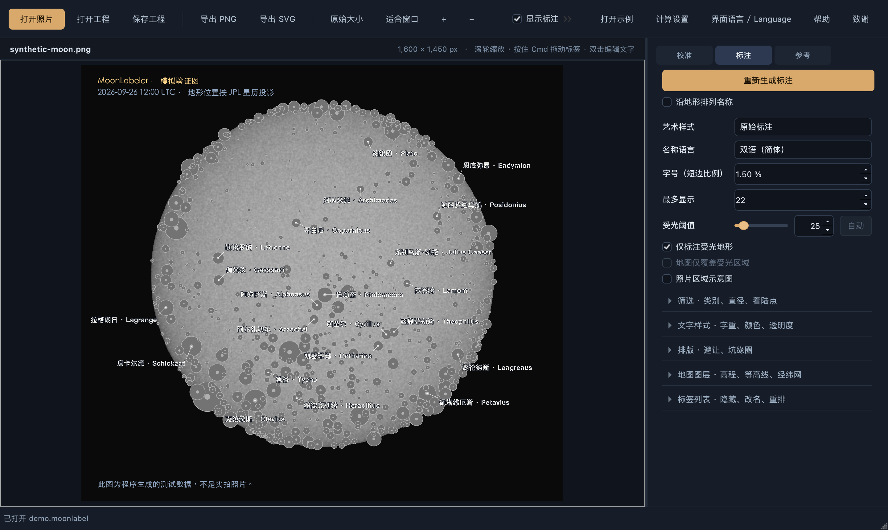

# MoonLabeler

**源码 / Source 0.12.4** · Fluorine Zhu · GPL-3.0-or-later

为月面照片配准、编辑地名，并导出 PNG / SVG。

Register lunar photographs, edit terrain labels, and export annotated PNG or SVG images.

[中文](#中文) · [English](#english) · [详细使用说明](README.zh-CN.md) · [仓库资源](#仓库内置资源) · [更新记录 / Release notes](UPDATE_HISTORY.md) · [致谢 / Acknowledgements](ACKNOWLEDGEMENTS.md)



## 中文

### 0.12.4 更新

- **原始标注可选系统字体**：在「标注 → 文字样式 → 字体」中选择，再点击「重新生成标注」。
- 字体名称随工程保存；缺少字体或字形时沿用默认字体回退。艺术预设保留自己的字体。
- PNG 固定文字外观，SVG 保留可编辑文字；要在另一台电脑保持 SVG 外观，需安装相应字体。

完整变化见[更新记录](UPDATE_HISTORY.md#0124)，已发布应用的下载入口在[下方](#下载应用--app-downloads)。

### 快速开始

1. 打开照片，核对拍摄日期与 **UTC 时间**；初始默认 UTC 15:00，北京时间需减 8 小时，拍摄地点可选。
2. 点击 **“自动识别并标注”**。失败时可确认一两个已知点辅助自动配准，或用至少三个分散点手动校准。
3. 在标注页调整内容和样式，点击顶部 **“重新生成标注”**。按住 **Cmd / Ctrl** 拖动标签，双击改名。
4. 保存 `.moonlabel` 工程，或导出原尺寸 PNG / 可编辑 SVG。分享工程时附上原照片。

滚轮用于缩放画布和滚动面板，停在参数上不会改值。工具栏右侧 **“界面语言 / Language”** 或 **Cmd / Ctrl + Shift + L** 可切换简体中文、繁体中文和英文；后台任务可用状态栏 **“中止当前任务”** 取消。

### 功能一览

| 功能 | 支持内容 |
| --- | --- |
| 月面配准 | 自动识别、参考点辅助、手动校准；旋转、镜像及目镜后照片 |
| 识别蒙版 | 半透明红色画笔、直径滑块、橡皮擦、撤销 / 重做；自动识别和辅助找坑共用，随工程保存 |
| 地名标注 | 地形多选、名称编辑、系统字体、分档字号、自动避让、沿地形排字、阿波罗 / 嫦娥着陆点 |
| 艺术与地图 | 中世纪、旷野地形图、蓝晒、铜版、水墨朱砂、红警地形图；经纬网、高程、等高线、晨昏线 |
| 对照与调节 | 独立显示标注和蒙版；实际观测月相与中性黑底的照片区域示意图；文字不透明度、地图不透明度及受光阈值实时调节 |
| 保存与导出 | 工程保存配准和手工编辑；PNG 转换为 sRGB，SVG 保留可编辑文字与图线 |

蒙版仅影响识别，不影响标注或导出。艺术主题使用去色后的显示底图，切回“原始标注”可恢复；原图和配准保留。操作细节见[中文指南](README.zh-CN.md)。

### 仓库内置资源

**地名和沿地形标注数据已经包含在 GitHub 仓库中，克隆或下载源码即可获得，无需另装资源包。**

| 数据 | 文件 | 用途 |
| --- | --- | --- |
| 地形目录 | [catalog.json](moonlabeler/data/catalog.json) | USGS / IAU 名称、位置和地形类别 |
| 中文地名 | [lunar_chinese_names.json](moonlabeler/data/lunar_chinese_names.json) | 约 2.78 MB；10,431 条资料，其中 9,040 条有中文名称，优先采用 LPND |
| 旧译名与别名 | [chinese_names.json](moonlabeler/data/chinese_names.json) | 搜索别名和缺项回退 |
| 沿地形标注路径 | [feature_paths.json](moonlabeler/data/feature_paths.json) | 约 0.17 MB，覆盖 206 处地形；供月溪、山脉等沿线排字 |
| 着陆点 | [landing_sites.json](moonlabeler/data/landing_sites.json) | 阿波罗与嫦娥着陆点坐标 |
| 月球示意图底图 | [moon_albedo_2k.jpg](moonlabeler/data/moon_albedo_2k.jpg) | 照片区域示意图使用的离线底图 |

中文地名及轮廓资料由樊仕达（[10deg](https://github.com/10deg/tsukikage)）提供；详见[地名来源记录](moonlabeler/data/lunar_chinese_names.provenance.json)和[第三方声明](THIRD_PARTY_NOTICES.md#nomenclature-translations-ephemerides-and-elevation)。沿地形标注读取精简路径，运行时不需要根目录的原始轮廓文件；[生成脚本](tools/prepare_feature_paths.py)可从未缩放的原始轮廓重新生成路径。山脉路径表示代表性走向，不是精测山脊。

星历和 LOLA 高程是另外的数据：源码首次使用相关功能时需下载约 20 MB 星历、约 33 MB 基础高程，缓存后可离线使用。它们不包含在源码仓库中。

### 从源码运行

目前维护 **macOS 和 Windows**，GitHub 测试矩阵覆盖这两个平台。需要 **Python 3.12+** 和 C++ 编译器。macOS 安装 Xcode Command Line Tools 后可运行 `./start-mac.command`；Windows 安装命令、可选组件及更新方法见下方[源码安装](#source-installation)。

识别可能受时间、阴影、模糊和畸变影响。基础高程采样约 1.9 km，坑缘圈和晨昏线仅供参考；拟合残差不等于绝对定位精度，着陆点不是航天器检测结果。照片在本机处理，主页示例为合成图。

## English

### New in 0.12.4

- **Choose an installed font for Original labels** in **Annotation → Text style → Font**, then click **Regenerate annotations**.
- The project keeps the font name and falls back for unavailable fonts or characters. Art presets keep their own fonts.
- PNG preserves the rendered appearance. SVG keeps text editable; install the relevant fonts when opening it on another computer to preserve its appearance.

See the [release notes](UPDATE_HISTORY.md#0124). Published app downloads are listed [below](#下载应用--app-downloads).

### Quick start

1. Open a photo and check its capture date and **UTC time**. The initial default is 15:00 UTC; observing location is optional.
2. Click **Identify and annotate**. If recognition fails, confirm one or two known features for assisted registration, or use at least three distributed points for manual calibration.
3. Adjust content and appearance, then click **Regenerate annotations**. Hold **Cmd** on macOS or **Ctrl** on Windows while dragging labels; double-click to rename them.
4. Save a `.moonlabel` project or export PNG/editable SVG at the original dimensions. Share the original photo with the project.

The wheel zooms the canvas or scrolls settings without changing parameter values. Use **Language / 中文** on the right or **Cmd / Ctrl + Shift + L** to switch between English, Simplified Chinese and Traditional Chinese. **Cancel task** in the status bar stops background work.

### Features

| Feature | Support |
| --- | --- |
| Registration | Automatic, reference-assisted and manual; rotated, mirrored and afocal photographs |
| Recognition mask | Translucent red brush, diameter slider, eraser, undo/redo; shared by recognition and assisted crater detection, saved with the project |
| Labels | Multiple terrain types, editable names, system fonts, relative font sizes, collision avoidance, landform paths and Apollo/Chang’e landing sites |
| Art and maps | Medieval, wilderness topographic, cyanotype, copperplate, ink/cinnabar and Red Alert terrain themes; grids, elevation, contours and terminators |
| Live controls | Independent label/mask previews, lunar locator with the observed phase and a neutral black panel, text/map opacity and photo-lit coverage |
| Projects and exports | Saved registration and manual edits; sRGB PNG and SVG with editable text and lines |

Masks affect recognition only. Art themes use a desaturated display copy; switching to Original annotations restores the original appearance after regeneration. The original image and registration are preserved. The [project format](docs/project-format.md) documents saved geometry and map integrations.

### Bundled resources

**The GitHub repository includes the name and landform-label resources. Cloning or downloading the source includes them; no separate resource pack is required.**

| Resource | File | Contents |
| --- | --- | --- |
| Terrain catalogue | [catalog.json](moonlabeler/data/catalog.json) | USGS / IAU names, positions and terrain types |
| Chinese names | [lunar_chinese_names.json](moonlabeler/data/lunar_chinese_names.json) | About 2.78 MB; 10,431 records, including 9,040 Chinese captions, with LPND preferred |
| Legacy translations | [chinese_names.json](moonlabeler/data/chinese_names.json) | Search aliases and missing-entry fallback |
| Landform label paths | [feature_paths.json](moonlabeler/data/feature_paths.json) | About 0.17 MB; 206 landforms for labels along rilles, ranges and other linear terrain |
| Landing sites | [landing_sites.json](moonlabeler/data/landing_sites.json) | Apollo and Chang’e coordinates |
| Lunar locator texture | [moon_albedo_2k.jpg](moonlabeler/data/moon_albedo_2k.jpg) | Offline background for the photo-footprint locator |

Name and outline data were supplied by 樊仕达 ([10deg](https://github.com/10deg/tsukikage)); see the [name provenance](moonlabeler/data/lunar_chinese_names.provenance.json) and [third-party notices](THIRD_PARTY_NOTICES.md#nomenclature-translations-ephemerides-and-elevation). Runtime reads the compact paths, without the large raw outline files. The [preparation script](tools/prepare_feature_paths.py) can regenerate paths from unscaled source geometry. Area-derived range axes are representative label routes, not surveyed crests.

Ephemerides and LOLA elevation are separate: source installs download about 20 MB and 33 MB respectively when needed, then cache them for offline use. They are not stored in this repository.

### Source installation

Maintained platforms are **macOS and Windows**, both covered by the GitHub test matrix. Requires **Python 3.12+** and a C++ compiler: Xcode Command Line Tools on macOS or Visual Studio Build Tools with **Desktop development with C++** on Windows. CMake and Ninja are installed by the build environment.

```bash
git clone https://github.com/Fluorine7/MoonLabeler.git
cd MoonLabeler
python3 -m venv .venv
# Windows: python -m venv .venv
source .venv/bin/activate
# Windows PowerShell: .venv\Scripts\Activate.ps1
python -m pip install --upgrade "pip>=26.2"
python -m pip install .
python -m moonlabeler
```

On macOS, `./start-mac.command` handles environment setup and launch. To update an existing checkout, activate its environment, run `git pull --ff-only`, then `python -m pip install .` and restart the app.

Optional extras: `python -m pip install ".[fits]"` for FITS or `".[gpu]"` for GPU terrain shading (`".[apple-gpu]"` for Apple MLX). **Compute settings** selects Auto or CPU-only; unavailable GPUs fall back to CPU. For migration from upstream OpenCV wheels, see the [0.8.0 notes](UPDATE_HISTORY.md#080).

Recognition can fail with inaccurate times, shadows, blur or distortion. Basic LOLA sampling is about 1.9 km; crater outlines and terminators are references, and fit residuals are not absolute positioning accuracy. Landing markers show coordinates, not detected spacecraft. Photos are processed locally; the bundled demo is synthetic.

## 下载应用 / App downloads

**0.12.2** 应用包包含新界面、沿地形标注与月相示意图，无需安装 Python。

系统字体选择和目镜边缘校正请使用当前 0.12.4 源码。

The **0.12.2** apps include the updated interface, landform labels and phase-correct lunar locator. Python is not required.

Use the current 0.12.4 source for system font selection and afocal edge correction.

| 系统 / Platform | 下载 / Download | 打开方式 / Start |
| --- | --- | --- |
| macOS 14.4+, Apple Silicon | [macOS ZIP](https://github.com/Fluorine7/MoonLabeler/releases/download/v0.12.2/MoonLabeler-0.12.2-macos-arm64.zip) | `MoonLabeler.app` |
| Windows x64 | [Windows ZIP](https://github.com/Fluorine7/MoonLabeler/releases/download/v0.12.2/MoonLabeler-0.12.2-windows-x64.zip) | `MoonLabeler.exe` |

完整解压后打开，内置运行环境、FITS 支持和离线星历。Windows 请保留 EXE 旁的 `_internal` 文件夹。Mac 包采用临时签名，首次被拦截时可在“系统设置 → 隐私与安全性”中允许；不支持 Intel Mac。

Extract the complete archive before opening. Python, FITS and offline ephemerides are included. Keep `_internal` beside the Windows EXE. The Mac app is ad-hoc signed; if blocked, allow it in System Settings → Privacy & Security. Intel Macs are not supported.

## 开发与许可 / Development and licence

开发环境安装 `python -m pip install ".[dev]"`，运行 `python -X warn_default_encoding -m pytest -q`；无桌面环境时设置 `QT_QPA_PLATFORM=offscreen`。

Install `python -m pip install ".[dev]"` and run `python -X warn_default_encoding -m pytest -q`. Set `QT_QPA_PLATFORM=offscreen` for headless tests.

构建 / Packaging: [macOS guide](docs/macos-app.md) · [Windows script](build-windows.ps1).

Copyright © 2026 Fluorine Zhu. Application code: [GPL-3.0-or-later](LICENSE). 数据来源与贡献者见[致谢 / Acknowledgements](ACKNOWLEDGEMENTS.md)，第三方条款见 [THIRD_PARTY_NOTICES.md](THIRD_PARTY_NOTICES.md).
